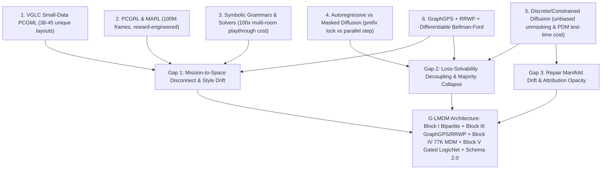

# Balanced Systematic Literature Synthesis: Neuro-Symbolic Dungeon PCG & Discrete Masked Diffusion (2010–2026)

**Structured Database:** [`docs/literature_review_corpus.csv`](literature_review_corpus.csv) (**45** verified works, UTF-8-SIG Excel-ready)  
**Unbiased Research Framing:** [`docs/RESEARCH_FRAMING_GAPS_RQ_RO.md`](RESEARCH_FRAMING_GAPS_RQ_RO.md) (bias self-audit, problem statement, `G1–G4`, falsifiable `RQ1–RQ4` / `RO1–RO4`, and honest novelty boundaries)

## 1. Search & Verification Protocol
- **Review Date:** 2026-11-24
- **Databases & Verification Sources:** Official arXiv API (`literature-search-arxiv` skill script `search_arxiv.py`, 36 unique preprints/published papers verified), OpenAlex, Crossref, Semantic Scholar, AAAI OJS, and OpenReview (`FsdB3I9Y24`).
- **License Notice:** Usage adheres to arXiv API Terms of Use (`https://info.arxiv.org/help/api/index.html`; recorded in `.licenses/literature_search_arxiv_LICENSE.txt`). Individual preprint licenses remain with their respective authors/venues.

## 2. Corpus Coverage by Theme

| Theme | Count | Representative Paradigms |
|---|---:|---|
| `1_VGLC_PCGML_SmallData` | 12 | VGLC Corpus, Graph+GAN, Hybrid CPPN-GAN, CVAE/Blending, CTE, Five-Dollar Model, Multiverse |
| `2_PCGRL_RL_Search` | 5 | PCGRL, Controllable PCGRL, Path of Destruction, Jax-PCGRL+, Multi-Agent PCGRL |
| `3_Symbolic_Grammar_Constraint` | 7 | Dormans Mission-Space Grammar, ASP, WFC, Sturgeon, Sturgeon-MKIV, Evo-WFC |
| `4_Autoregressive_LLM_vs_MDM` | 5 | MarioGPT, LLM Sokoban, MGDM vs AR, Token-Ordering MDM, SearchDiff |
| `5_Discrete_Constrained_Diffusion` | 12 | MaskGIT, MD4, MDLM, ReMDM, PDM (NeurIPS 2024), Masked CFG, Sokoban MD4, CDC, Discrete Playground, Floorcheck |
| `6_Graph_DiffPlanning_Foundations` | 4 | GraphGPS, GRIT (RRWP), Value Iteration Networks, Blackbox Combinatorial Solver Differentiation |

## 3. Conceptual Gap-to-Architecture Mapping

## 4. Balanced Thematic Synthesis (Non-Biased Positioning)
1. **VGLC Small-Data PCGML (`n=12`):** Across 18 VGLC *The Legend of Zelda* files, deduplication shrinks the corpus to ~38–45 unique interiors (`Schrum et al., 2022`; confirmed locally: `45` unique interiors across D1–D8, with `95/101 = 94.1%` D9 overlap). Standard room-level splits leak templates (`Atmakuri et al., 2023`), while greedy decoding on skewed tile distributions drops rare functional tiles (`Jadhav & Guzdial, 2022`).
2. **PCGRL & MARL Alternatives (`n=5`):** RL-based generators (`Khalifa et al., 2020`; `Earle et al., 2021, 2024, 2025`) optimize playability directly without human datasets and generalize OOD with egocentric multi-agent windows (`Earle et al., 2025`), but rely on long RL training / expensive per-step shortest-path rewards rather than learning corpus distributions in 8 parallel steps.
3. **Symbolic Grammars, ASP & WFC (`n=7`):** Pure symbolic methods excel at single-room ASP (`Smith & Mateas, 2011`) and local WFC (`Karth & Smith, 2017/2022`), yet local pattern rules fail global lock-and-key constraints (`Rajesh et al., 2026`), and unifying grammar rewriting with multi-step playthrough proofs scales ~100x slower (`Cooper & Bazzaz, 2024/2025`: `6.07s -> 585.38s` median). This motivates clean mission-vs-geometry decoupling (`Dormans, 2010`).
4. **Autoregressive Transformers vs. Bidirectional Masked Diffusion (`n=5`):** Causal 1D LLMs handle sequence style (`MarioGPT`, `Sudhakaran et al., 2023`) but suffer boundary-socket mismatch and poor rare-token/global-path control on small 2D grids (`Todd et al., 2023`). Bidirectional MDMs outperform AR on combinatorial grid planning (`Ye et al., 2025`; `Kim et al., 2025`; `Ta et al., 2026`), though independent parallel token commits necessitate corrector remasking.
5. **Discrete & Constrained Diffusion (`n=12`):** Confidence-based unmasking (`MaskGIT`, `Chang et al., 2022`) acts implicitly as low-temperature sampling (`Hayakawa et al., 2025`), inflating majority wall/floor counts (`Baghal, 2026`: `69.5% -> 81.5%`), whereas test-time projection (`PDM`, `Christopher et al., NeurIPS 2024`) adds per-step solver overhead and noise-schedule mismatch (`Reviewer e4oh`). G-LMDM replaces test-time projection with train-time mask-gated `(1-m)^2` differentiable Bellman-Ford regularization (`0 ms` inference overhead), uniform random unmasking, and `Cond / Cond+ / Post+` attribution via Schema 2.0 + TV/JS-divergence (`Shao et al., 2026`).
6. **Graph & Differentiable Planning Foundations (`n=4`):** `GraphGPS` (`Rampasek et al., 2022`) and `RRWP` (`Ma et al., 2023`) capture topological distances on mission graphs, while `VIN` (`Tamar et al., 2016`) and blackbox differentiation (`Vlastelica et al., 2020`) anchor G-LMDM's soft Bellman-Ford regularizer.

## 5. Verified Corpus Bibliography & URLs (45 Papers)

| # | ID | Theme | Year | Venue | Title | URL |
|---:|---|---|---:|---|---|---|
| 1 | `Summerville2016_VGLC` | `1_VGLC_PCGML_SmallData` | 2016 | PCG Workshop @ FDG/DiGRA | The VGLC: The Video Game Level Corpus | https://arxiv.org/abs/1606.07487 |
| 2 | `Gutierrez2020_GraphGAN` | `1_VGLC_PCGML_SmallData` | 2020 | IEEE CEC | Generative Adversarial Network Rooms in Generative Graph Grammar Dungeons for The Legend of Zelda | https://arxiv.org/abs/2001.05065 |
| 3 | `Torrado2020_BootstrappedGAN` | `1_VGLC_PCGML_SmallData` | 2020 | IEEE CoG | Bootstrapping Conditional GANs for Video Game Level Generation | https://arxiv.org/abs/1910.01603 |
| 4 | `Sarkar2021_CVAEBlend` | `1_VGLC_PCGML_SmallData` | 2021 | IEEE CoG | Dungeon and Platformer Level Blending and Generation using Conditional VAEs | https://arxiv.org/abs/2106.12692 |
| 5 | `Zhou2021_TransferDungeon` | `1_VGLC_PCGML_SmallData` | 2021 | FDG PCG Workshop | Toward Co-creative Dungeon Generation via Transfer Learning | https://arxiv.org/abs/2107.12533 |
| 6 | `Jadhav2022_CTE` | `1_VGLC_PCGML_SmallData` | 2022 | AIIDE | Clustering-based Tile Embedding (CTE): A General Representation for Level Design with Skewed Tile Distributions | https://arxiv.org/abs/2210.12789 |
| 7 | `Schrum2022_HybridEncoding` | `1_VGLC_PCGML_SmallData` | 2022 | IEEE Transactions on Games (ToG) | Hybrid Encoding For Generating Large Scale Game Level Patterns With Local Variations | https://arxiv.org/abs/2105.12960 |
| 8 | `Atmakuri2023_LevelBlend` | `1_VGLC_PCGML_SmallData` | 2023 | IEEE CoG | Game Level Blending using a Learned Level Representation | https://arxiv.org/abs/2306.16666 |
| 9 | `Bazzaz2023_ActiveCompletability` | `1_VGLC_PCGML_SmallData` | 2023 | IEEE CoG | Active Learning for Classifying 2D Grid-Based Level Completability | https://arxiv.org/abs/2309.04367 |
| 10 | `Merino2023_FiveDollar` | `1_VGLC_PCGML_SmallData` | 2023 | AIIDE | The Five-Dollar Model: Generating Game Maps and Sprites from Sentence Embeddings | https://arxiv.org/abs/2308.04052 |
| 11 | `Sarkar2023_PCGKT` | `1_VGLC_PCGML_SmallData` | 2023 | IEEE Transactions on Games (ToG) | Procedural Content Generation via Knowledge Transformation (PCG-KT) | https://www.semanticscholar.org/paper/Procedural-Content-Generation-via-Knowledge-Sarkar-Guzdial/0c7dd88f0cedf68c6cc00ff6f299fd6e7b5bf7cc |
| 12 | `Baek2026_Multiverse` | `1_VGLC_PCGML_SmallData` | 2026 | IEEE CoG / arXiv | Multiverse: Language-Conditioned Multi-Game Level Blending via Shared Representation | https://arxiv.org/abs/2603.26782 |
| 13 | `Khalifa2020_PCGRL` | `2_PCGRL_RL_Search` | 2020 | AIIDE | PCGRL: Procedural Content Generation via Reinforcement Learning | https://arxiv.org/abs/2001.09212 |
| 14 | `Earle2021_ControllablePCGRL` | `2_PCGRL_RL_Search` | 2021 | IEEE CoG | Learning Controllable Content Generators | https://arxiv.org/abs/2105.02993 |
| 15 | `Siper2023_ControllablePoD` | `2_PCGRL_RL_Search` | 2023 | IEEE CoG | Controllable Path of Destruction | https://arxiv.org/abs/2305.18553 |
| 16 | `Earle2024_PCGRLPlus` | `2_PCGRL_RL_Search` | 2024 | IEEE CoG | PCGRL+: Scaling, Control and Generalization in Reinforcement Learning Level Generators | https://arxiv.org/abs/2408.12525 |
| 17 | `Earle2025_MultiAgentPCGRL` | `2_PCGRL_RL_Search` | 2025 | AIIDE | Video Game Level Design as a Multi-Agent Reinforcement Learning Problem | https://arxiv.org/abs/2510.04862 |
| 18 | `Dormans2010_MissionSpace` | `3_Symbolic_Grammar_Constraint` | 2010 | PCGames @ FDG | Adventures in level design: generating missions and spaces for action adventure games | https://doi.org/10.1145/1814256.1814257 |
| 19 | `Smith2011_ASP_PCG` | `3_Symbolic_Grammar_Constraint` | 2011 | IEEE TCIAIG | Answer Set Programming for Procedural Content Generation: A Design Space Approach | https://doi.org/10.1109/tciaig.2011.2158545 |
| 20 | `Karth2017_WFC_FDG` | `3_Symbolic_Grammar_Constraint` | 2017 | FDG | WaveFunctionCollapse is constraint solving in the wild | https://doi.org/10.1145/3102071.3110566 |
| 21 | `Cooper2022_Sturgeon` | `3_Symbolic_Grammar_Constraint` | 2022 | AIIDE | Sturgeon: Tile-Based Procedural Level Generation via Learned and Designed Constraints | https://ojs.aaai.org/index.php/AIIDE/article/view/21944 |
| 22 | `Karth2022_WFC_ToG` | `3_Symbolic_Grammar_Constraint` | 2022 | IEEE Transactions on Games (ToG) | WaveFunctionCollapse: Content Generation via Constraint Solving and Machine Learning | https://doi.org/10.1109/tg.2021.3076368 |
| 23 | `Cooper2024_SturgeonMKIV` | `3_Symbolic_Grammar_Constraint` | 2024 | AIIDE / EXAG@AIIDE 2025 | Sturgeon-MKIV: Constraint-Based Level and Playthrough Generation with Graph Label Rewrite Rules | https://ojs.aaai.org/index.php/AIIDE/article/view/31862 |
| 24 | `Rajesh2026_EvoWFC` | `3_Symbolic_Grammar_Constraint` | 2026 | IEEE CoG | Evolutionary Wave Function Collapse | https://arxiv.org/abs/2607.02082 |
| 25 | `Sudhakaran2023_MarioGPT` | `4_Autoregressive_LLM_vs_MDM` | 2023 | NeurIPS | MarioGPT: Open-Ended Text2Level Generation through Large Language Models | https://arxiv.org/abs/2302.05981 |
| 26 | `Todd2023_LLMLevels` | `4_Autoregressive_LLM_vs_MDM` | 2023 | FDG | Level Generation Through Large Language Models | https://arxiv.org/abs/2302.05817 |
| 27 | `Kim2025_TokenOrderingMDM` | `4_Autoregressive_LLM_vs_MDM` | 2025 | ICML | Train for the Worst, Plan for the Best: Understanding Token Ordering in Masked Diffusions | https://arxiv.org/abs/2502.06768 |
| 28 | `Ye2025_BeyondAR_MGDM` | `4_Autoregressive_LLM_vs_MDM` | 2025 | ICLR | Beyond Autoregression: Discrete Diffusion for Complex Reasoning and Planning | https://arxiv.org/abs/2410.14157 |
| 29 | `Ta2026_SearchDiff` | `4_Autoregressive_LLM_vs_MDM` | 2026 | arXiv | Search-Augmented Masked Diffusion Models for Constrained Generation | https://arxiv.org/abs/2602.02727 |
| 30 | `Chang2022_MaskGIT` | `5_Discrete_Constrained_Diffusion` | 2022 | CVPR | MaskGIT: Masked Generative Image Transformer | https://arxiv.org/abs/2202.04200 |
| 31 | `Christopher2024_PDM_NeurIPS` | `5_Discrete_Constrained_Diffusion` | 2024 | NeurIPS (OpenReview Poster) | Constrained Synthesis with Projected Diffusion Models | https://openreview.net/forum?id=FsdB3I9Y24 |
| 32 | `Sahoo2024_MDLM` | `5_Discrete_Constrained_Diffusion` | 2024 | NeurIPS | Simple and Effective Masked Diffusion Language Models | https://arxiv.org/abs/2406.07524 |
| 33 | `Shi2024_MD4` | `5_Discrete_Constrained_Diffusion` | 2024 | NeurIPS | Simplified and Generalized Masked Diffusion for Discrete Data | https://arxiv.org/abs/2406.04329 |
| 34 | `Christopher2025_NeuroSymbolicDiff` | `5_Discrete_Constrained_Diffusion` | 2025 | NeuS | Neuro-Symbolic Generative Diffusion Models for Physically Grounded, Robust, and Safe Generation | https://arxiv.org/abs/2506.01121 |
| 35 | `Hayakawa2025_DemystifyingMaskGIT` | `5_Discrete_Constrained_Diffusion` | 2025 | TMLR | Demystifying MaskGIT Sampler and Beyond: Adaptive Order Selection in Masked Diffusion | https://arxiv.org/abs/2510.04525 |
| 36 | `Rojas2025_MaskedCFG` | `5_Discrete_Constrained_Diffusion` | 2025 | arXiv | Improving Classifier-Free Guidance in Masked Diffusion: Low-Dim Theoretical Insights with High-Dim Impact | https://arxiv.org/abs/2507.08965 |
| 37 | `Wang2025_ReMDM` | `5_Discrete_Constrained_Diffusion` | 2025 | NeurIPS | Remasking Discrete Diffusion Models with Inference-Time Scaling | https://arxiv.org/abs/2503.00307 |
| 38 | `Baghal2026_SokobanDiffusion` | `5_Discrete_Constrained_Diffusion` | 2026 | arXiv | Solvable Sokoban Without a Solver via Diffusion | https://arxiv.org/abs/2608.15958 |
| 39 | `Shao2026_CDC_DiscreteCode` | `5_Discrete_Constrained_Diffusion` | 2026 | arXiv | Constrained Code Generation with Discrete Diffusion | https://arxiv.org/abs/2605.16829 |
| 40 | `Shao2026_DiscretePlayground` | `5_Discrete_Constrained_Diffusion` | 2026 | NeurIPS (Datasets & Benchmarks) | Discrete Diffusion Playground: A 2D Benchmark for Discrete Generative Models | https://arxiv.org/abs/2611.11068 |
| 41 | `Shao2026_FloorPlansStop` | `5_Discrete_Constrained_Diffusion` | 2026 | arXiv | Where Generated Floor Plans Stop: Calibrated Sample-Level Checks Against a Built Baseline | https://arxiv.org/abs/2611.00063 |
| 42 | `Tamar2016_VIN` | `6_Graph_DiffPlanning_Foundations` | 2016 | NeurIPS | Value Iteration Networks | https://arxiv.org/abs/1602.02867 |
| 43 | `Vlastelica2020_BlackboxDiff` | `6_Graph_DiffPlanning_Foundations` | 2020 | ICLR (Spotlight) | Differentiation of Blackbox Combinatorial Solvers | https://arxiv.org/abs/1912.02175 |
| 44 | `Rampasek2022_GraphGPS` | `6_Graph_DiffPlanning_Foundations` | 2022 | NeurIPS | Recipe for a General, Powerful, Scalable Graph Transformer | https://arxiv.org/abs/2205.12454 |
| 45 | `Ma2023_GRIT_RRWP` | `6_Graph_DiffPlanning_Foundations` | 2023 | ICML (PMLR 202) | Graph Inductive Biases in Transformers without Message Passing | https://arxiv.org/abs/2305.17589 |
