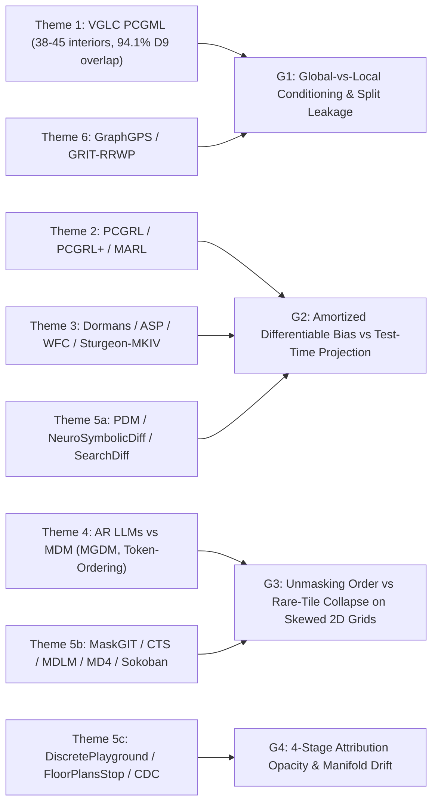

# Unbiased Research Framing: Problem Statement, Literature Gaps, RQs, ROs, and Honest Novelty

**Companion Synthesis:** [`LITERATURE_REVIEW_SYNTHESIS.md`](LITERATURE_REVIEW_SYNTHESIS.md)  
**Verified Literature Database:** [`literature_review_corpus.csv`](literature_review_corpus.csv) (**45** verified works, 2010–2026)  
**Benchmark Protocol:** [`scripts/evaluate_glmdm_benchmark.py`](../scripts/evaluate_glmdm_benchmark.py)  
**Status:** Pre-training scientific framing (4-fold evaluation pending; zero empirical superiority claims made prior to evaluation).

---

## 1. Bias Self-Audit of the Prior RQ/RO Draft

Before formulating the revised framing, this section explicitly diagnoses **four methodological and rhetorical biases** identified in our earlier draft RQs/ROs so they are not reintroduced in experiments or manuscript writing:

| Bias Type | Defect in Prior Draft | Why It Fails Peer Review | Correction Applied in This Document |
|---|---|---|---|
| **1. Solution-Leading Yes/No RQs** | Earlier `RQ1`/`RQ2` embedded our own implementation choices (`GraphGPS + RRWP`, `uniform random unmasking`, `mask-gated LogicNet (1-m)^2`) directly inside yes/no questions ("does X improve Y?"). | Assumes the superiority of the proposed architecture a priori and reduces empirical inquiry to confirmation rather than mechanism comparison. | Rewritten as open, mechanism-agnostic `"How / To what extent / What trade-offs"` questions that compare **conditioning scope**, **constraint enforcement timing**, and **sampling order**. |
| **2. Engineering Checklists Disguised as ROs** | Earlier `RO1`/`RO2` hardcoded module labels, parameter targets (`<= 100K` denoiser, `96-dim`), and implementation fixes (`2-tile border apron`, `(1-m)^2` gate) inside Research Objectives. | Confuses *building a specific system* with *establishing scientific knowledge*. Reviewers expect ROs to remain valid even if an alternative architecture wins. | `RO1–RO4` now state abstract, generalizable scientific objectives; codebase configurations (`glmdm_*.yaml`) are isolated in Section 6. |
| **3. HARKing & Bugfix Inflation** | Earlier framing risked presenting coordinate-alignment bugfixes (e.g., fixing outer-wall target masks in `LogicNet`, removing a `5.6x` sampler-step confounder, adding `BLOCK` to `RARE_TILES`) as methodological "novelty". | Fixing data bugs, misaligned masks, and broken baselines is **engineering hygiene**, not a scientific contribution. Presenting repaired bugs as novelty violates empirical integrity. | Section 7 strictly separates **Engineering Hygiene & Root-Cause Fixes** (non-novel prerequisites) from **Conditional Scientific Contributions** (valid only if supported by 4-fold runs). |
| **4. Paradigm Strawmanning** | Risk of portraying symbolic solvers (`ASP`, `WFC`, `Sturgeon`), RL (`PCGRL`, `PCGRL+`, `MARL`), or test-time projection (`PDM`) as universally inferior rather than characterizing exact trade-off regimes. | `Smith2011_ASP_PCG` is fast on single grids; `Earle2024_PCGRLPlus`/`Earle2025_MultiAgentPCGRL` generalize OOD without training corpora; `Christopher2024_PDM_NeurIPS` and `Ta2026_SearchDiff` offer hard step-wise guarantees when solver latency is affordable. | Section 3 and Section 7 explicitly state where competing paradigms excel and position train-time amortization + symbolic compilation strictly within the **small-data, multi-room lock-and-key, low-latency** regime. |

---

## 2. Mechanism-Agnostic Problem Statement

Procedural generation of multi-room action-adventure dungeons (*The Legend of Zelda* VGLC benchmark; `Summerville2016_VGLC`) must simultaneously satisfy **three competing requirements** under extreme data scarcity:

1. **Global Combinatorial Solvability:** A generated dungeon must realize an acyclic/bipartite lock-and-key progression graph (start-to-goal reachability across locked doors, small keys, boss keys, and multi-room detours) without softlocks (`Dormans2010_MissionSpace`).
2. **Local Geometric & Distributional Fidelity under Template Scarcity & Tile Skew:** Room interiors must match human-authored spatial semantics despite severe template scarcity and class imbalance. Local audit of the VGLC Zelda corpus (`ZeldaRoomDataset`) establishes:
   - Training set (`D1–D8`): `349` rooms containing only **`45` unique exact interiors** (identical under Klein $V_4$ reflection canonicalization; consistent with `Schrum2022_HybridEncoding` reporting ~38–45 unique interiors).
   - Interior tile distribution is heavily skewed: `FLOOR = 81.24%`, `BLOCK = 8.61%` (present in `171/349 = 49.0%` of rooms), `ELEMENT = 6.26%`, `ELEMENT_FLOOR = 2.37%`, `ENEMY = 1.43%`, `STAIR = 0.10%`, and interior `WALL = 0.0%`.
   - Holdout set (`D9`): `101` rooms, `33` unique interiors, of which **`95/101` (`94.1%`) are exact interior copies already present in `D1–D8`**, leaving only **`5/33`** unseen room templates.
3. **Attribution Transparency & Matched-Compute Efficiency:** Hybrid neuro-symbolic pipelines frequently bundle learned room generators with deterministic post-hoc repair/search (`StateSpaceAStar`, constraint projection). Without decomposed reporting, it is impossible to verify whether validity comes from the learned generative prior or from symbolic post-processing, or whether post-hoc repair distorts the learned tile distribution (`Christopher2025_NeuroSymbolicDiff`).

**Core Scientific Tension:**  
Under extreme template scarcity (~45 unique room prototypes) and skewed categorical tiles, **purely symbolic global solvers** guarantee validity at high combinatorial search latency (`Cooper2024_SturgeonMKIV`), **unconstrained generative priors** suffer structural disconnection and majority-class (`FLOOR`/`WALL`) collapse (`Jadhav2022_CTE`; `Baghal2026_SokobanDiffusion`), and **post-hoc/step-wise repair** either shifts samples off the data manifold (`Christopher2025_NeuroSymbolicDiff`) or adds inference-time solver overhead (`Ta2026_SearchDiff`). How to allocate responsibility across graph conditioning, discrete sampling order, amortized differentiable regularization, and exact symbolic verification—and measure each component's causal contribution without leakage—remains unresolved.

---

## 3. Literature-Grounded Research Gaps (`G1–G4`)

Grounded in the 45 verified works in [`literature_review_corpus.csv`](literature_review_corpus.csv):

### `G1`: Unisolated Effect of Global Mission-Graph Conditioning Under Extreme Template Scarcity and Split Leakage
- **Evidence in Literature:** `Schrum2022_HybridEncoding` and `Zhou2021_TransferDungeon` show VGLC Zelda collapses to ~38–45 unique rooms when deduplicated; `Atmakuri2023_LevelBlend` and `Baek2026_Multiverse` evaluate on random room-level splits (`85/10/5` or `80/20`) that leak repeated templates across train and test. Early graph-room hybrids (`Gutierrez2020_GraphGAN`) strip VGLC down to 3 tiles (`floor`/`wall`/`water`) and ignore mission-graph context when generating rooms. Meanwhile, `Earle2024_PCGRLPlus` shows global coordinate observations overfit on out-of-distribution grids compared to local egocentric views.
- **Competing Strengths:** Local-only or unconditional generators carry fewer conditioning parameters (`Merino2023_FiveDollar`) and risk less overfitting when unique room templates are scarce.
- **The Gap:** Under leakage-free **dungeon-grouped cross-validation** and explicit Klein-$V_4$ memorization auditing, it remains unestablished whether relational global mission-graph conditioning (topological distances + neighboring rooms) actually improves raw room compatibility and distributional fidelity over simpler local node+neighbor conditioning—or merely memorizes training dungeon signatures.

### `G2`: Missing Quantitative Trade-Off Characterization Between Train-Time Differentiable Reachability Bias, Test-Time Solver Search, and Post-Hoc Repair
- **Evidence in Literature:** Purely symbolic playthrough unification (`Cooper2024_SturgeonMKIV`) jumps median solving latency ~100× (`6.07s` graph-only to `585.38s` median / `1625.65s` max with mechanic playthroughs), while local WFC rules fail global Zelda lock-and-key progression (`Rajesh2026_EvoWFC`). On the RL side, `Khalifa2020_PCGRL` and `Earle2025_MultiAgentPCGRL` optimize solvability directly without human corpora via `100M`-frame RL or $O(N^2)$ per-step shortest-path rewards, trading off corpus fidelity and reward-engineering effort. In discrete diffusion, `Christopher2024_PDM_NeurIPS` (NeurIPS 2024 OpenReview `FsdB3I9Y24`) and `Ta2026_SearchDiff` enforce constraints via step-wise test-time projection or black-box verifier search, incurring per-step solver overhead and—at high noise levels $t$—projection off the noise schedule (flagged by Reviewer `e4oh` in `FsdB3I9Y24`), whereas `Christopher2025_NeuroSymbolicDiff` shows post-hoc projection sharply degrades sample quality. Conversely, `Bazzaz2023_ActiveCompletability` shows neural reachability surrogates remain fallible (`FDR > FOR`).
- **The Gap:** For multi-room lock-and-key dungeons, there is no controlled comparison measuring whether an **amortized, noise/mask-gated differentiable shortest-path regularizer** during training (`Tamar2016_VIN`-style soft Bellman-Ford, zero inference overhead) reduces symbolic repair burden without degrading distributional fidelity—versus simply omitting differentiable regularization and relying on local symbolic post-hoc repair.

### `G3`: Under-Explored Interaction Between Discrete Unmasking Order and Skewed Functional Tile Preservation on Constrained 2D Grids
- **Evidence in Literature:** `Sudhakaran2023_MarioGPT` (`68%` rare-enemy accuracy) and `Todd2023_LLMLevels` (`0.02–0.04` playability on small Microban) show autoregressive causal ordering struggles with rare tokens and global path constraints on small 2D grids. Bidirectional masked diffusion (`Ye2025_BeyondAR_MGDM`) overcomes causal prefix lock-in, yet sampling schedule matters critically: `Hayakawa2025_DemystifyingMaskGIT` proves confidence-ranked unmasking (`Chang2022_MaskGIT`) acts implicitly as low-temperature sampling, `Kim2025_TokenOrderingMDM` shows probability-margin vs. random unmasking shifts Sudoku accuracy from `6.88%` to `89.49%` depending on constraint uniformity, and `Baghal2026_SokobanDiffusion` demonstrates empirically on 2D Sokoban that confidence unmasking inflates majority wall tiles (`69.5% -> 81.5%`) and degrades puzzle quality while cross-entropy loss fails to predict solvability ("loss-solvability decoupling"). Additionally, `Rojas2025_MaskedCFG` shows unnormalized Classifier-Free Guidance ($w > 1$) collapses non-dominant features.
- **The Gap:** On heavily skewed 2D room grids (`81.24%` `FLOOR`, `8.61%` `BLOCK`, `1.43%` `ENEMY`), the exact trade-off between **confidence-based**, **margin-based**, and **uniform random unmasking**—jointly measuring majority collapse (`BLOCK=0`), `raw` solvability, and `JS`/`TV` distributional fidelity—has not been tested under controlled small-data training.

### `G4`: Attribution Opacity, Generic Metric Misuse, and Unmeasured Repair Manifold Drift
- **Evidence in Literature:** Reviewers of `Christopher2024_PDM_NeurIPS` criticized reliance on FID/cross-entropy in constrained synthesis without domain sample-quality metrics or matched-compute accounting. `Shao2026_DiscretePlayground` confirms cross-entropy denoising loss fails to detect `Total Variation (TV)` and `KL` drift on invalid 2D cells; `Shao2026_FloorPlansStop` shows graph-compatibility metrics saturate (`ROC AUC 0.43–0.53`) and fail to reflect true sample-level geometric validity. Meanwhile, `Shao2026_CDC_DiscreteCode` emphasizes measuring exact **edit footprint** (`12–35` localized edits vs. `98–123` post-hoc regeneration).
- **The Gap:** Most hybrid PCG papers report only final repaired pass rates (`100%` solvable), conflating neural prior quality with symbolic repair. There is a lack of **stage-wise causal attribution** (`raw -> constrained -> repaired -> compiled`) paired with **pre- vs. post-repair distributional drift (`JS`/`TV`)**, **edit footprint**, **matched-compute throughput**, and **canonical $V_4$ novelty** relative to deduplicated training rooms.

---

## 4. Unbiased, Falsifiable Research Questions (`RQ1–RQ4`) & Dual Hypotheses

Every RQ below is deliberately framed **without pre-judging the outcome** and includes explicit **supporting (`Ha`)** and **null/refutation (`H0`)** hypotheses so negative results remain scientifically informative.

### `RQ1` — Conditioning Scope vs. Small-Data Overfitting
> **Question:** *Under extreme room-template scarcity (~45 unique interiors) and leakage-free dungeon-grouped cross-validation, how does conditioning a discrete room generator on full relational mission-graph topology and neighbor layouts affect raw structural validity, interior tile fidelity, and template memorization relative to local node-and-boundary conditioning?*

- **Alternative Hypothesis (`H1a`):** Relational mission-graph conditioning (multi-hop graph structure + neighboring rooms) yields higher `raw_door_connectivity_rate` and stronger layout coherence (`mean_linearity`, `mean_optimal_path_length` alignment) than local pooled conditioning without increasing `train_v4_match_rate`.
- **Null / Refutation Hypothesis (`H10`):** On only 8 training dungeons (~45 unique interiors), higher-dimensional relational graph conditioning either shows no significant improvement over local boundary conditioning (`p >= 0.05` across 4 folds) or increases dungeon-level memorization / variance across held-out dungeon folds (`D9` / LODO folds).

### `RQ2` — Train-Time Differentiable Reachability Regularization vs. Post-Hoc Symbolic Repair
> **Question:** *In a decoupled neuro-symbolic dungeon generator, what is the trade-off between incorporating a noise/mask-gated differentiable reachability regularizer during training versus omitting it and relying solely on exact post-hoc symbolic repair—measured in repair edit footprint, raw solvability, interior tile distribution (`JS`/`TV`), and valid dungeons per compute-second?*

- **Alternative Hypothesis (`H2a`):** Noise/mask-gated differentiable reachability regularization reduces `repair_rate` and `tiles_repaired_mean` on `raw` samples and increases `zero_repair_dungeons_per_sec` relative to an unregularized discrete generator, while keeping `js_div_raw_vs_vglc` lower than heavy post-hoc repair drift.
- **Null / Refutation Hypothesis (`H20`):** Either (i) differentiable reachability regularization fails to reduce symbolic repair cost meaningfully across unseen folds (`H20-null`), or (ii) it reduces repair rate only by **over-smoothing** interiors toward trivially empty/open `FLOOR` layouts (raising `js_div_raw_vs_vglc`, lowering `raw_interior_distribution.BLOCK` / `raw_rooms_with_block_rate`, and hurting `mean_leniency` — *good-for-nothing reachability shortcut*).

### `RQ3` — Discrete Unmasking Order & Rare Functional Tile Collapse
> **Question:** *How does inference unmasking order (`uniform random` vs. `confidence-ranked`) interact with rare-tile loss weighting on heavily skewed 2D room grids (`>80%` background floor, `<10%` functional obstacles/elements) with respect to rare-tile recall (`BLOCK`, `ENEMY`, `ELEMENT`), distribution divergence (`JS`/`TV`), and `raw` room traversability?*

- **Alternative Hypothesis (`H3a`):** Confidence-ranked unmasking induces early background `FLOOR` cascades (reducing `raw_interior_distribution.BLOCK` / `raw_rooms_with_block_rate` and inflating `js_div_raw_vs_vglc`), whereas uniform random unmasking at $T=1.0$ preserves rare functional tile densities closer to VGLC ground truth (`Hayakawa2025_DemystifyingMaskGIT`; `Baghal2026_SokobanDiffusion`).
- **Null / Refutation Hypothesis (`H30`):** Random unmasking degrades local geometric coherence and raises `raw` unsolvability / `tiles_repaired_mean` compared to confidence unmasking enough to offset any gain in tile-frequency calibration (`JS`/`TV`).

### `RQ4` — Stage-Wise Attribution, Manifold Drift, and Generalization Under Corpus Repetition
> **Question:** *Decomposing hybrid generation into `raw -> constrained -> repaired -> compiled` stages under dungeon-grouped cross-validation, how much of final solvability and distribution shift is attributable to the neural prior versus symbolic repair, and how accurately do held-out metrics distinguish genuine structural generalization from $V_4$ template reuse (given `94.1%` interior overlap in `D9`)?*

- **Alternative Hypothesis (`H4a`):** Stage-wise attribution (`Cond / Cond+ / Post+` style) exposes non-trivial differences between models that appear identical after symbolic compilation (`100%` compiled solvability), revealing measurable repair distribution shift (`repair_shift_js`) and template-memorization vs. true unseen-layout generalization gaps between seen-template (`94.1%`) and unseen-template (`5/33`) evaluation slices.
- **Null / Refutation Hypothesis (`H40`):** Post-hoc symbolic repair achieves near-identical `JS`, `ERA`, and throughput across all neural priors regardless of `raw` prior quality (implying the symbolic repair/assembler stage dominates output quality and the neural prior adds negligible value over simpler local baselines).

---

## 5. Unbiased Research Objectives (`RO1–RO4`)

Notice that **no objective below assumes a specific model wins or hardcodes implementation parameters**:

- **`RO1` (Conditioning Granularity Characterization):** Quantify, under leakage-free dungeon-grouped $K$-fold cross-validation (`4` folds across `D1–D9`) with matched optimization budgets, how global mission-graph + neighbor conditioning compares against local node+boundary conditioning on `raw` constraint satisfaction, distributional fidelity, and $V_4$-canonical novelty.
- **`RO2` (Constraint-Timing & Amortization Audit):** Evaluate the empirical trade-off between amortized train-time differentiable reachability regularization (ablated into global+local vs. local-only vs. none) and unregularized priors paired with exact post-hoc symbolic repair, measuring edit footprint, distributional preservation, and matched-compute valid generation throughput.
- **`RO3` (Skewed-Grid Discrete Sampling Analysis):** Characterize the sensitivity of 2D discrete masked generators to inference unmasking schedules (`random` vs. `confidence`) on heavily skewed tile vocabularies, verifying whether `Baghal2026_SokobanDiffusion` / `Hayakawa2025_DemystifyingMaskGIT` majority-collapse findings generalize to multi-room Zelda dungeons.
- **`RO4` (Standardized Four-Stage Attribution & Generalization Benchmarking):** Establish a reproducible evaluation protocol reporting four-stage causal attribution (`raw -> constrained -> repaired -> compiled`), distribution divergence (`JS` and `TV` vs. VGLC), `repair_shift_js`, `ERA` metrics, matched-compute efficiency, and stratified novelty (`seen` vs. `unseen` VGLC templates).

---

## 6. Traceability Matrix (Scientific Layer vs. Experimental Instantiation)

| Scientific Layer (`Gap -> RQ -> RO`) | Hypotheses Tested | Controlled Experimental Factor in Repo | Primary Metrics ([`evaluate_glmdm_benchmark.py`](../scripts/evaluate_glmdm_benchmark.py)) |
|---|---|---|---|
| `G1 -> RQ1 -> RO1` (Global vs. Local Conditioning) | `H1a` vs. `H10` | **Arm `G`** ([`glmdm_g_graph.yaml`](../configs/glmdm_g_graph.yaml): GraphGPS + RRWP + neighbor maps) vs. **Arm `N`** ([`glmdm_n_local.yaml`](../configs/glmdm_n_local.yaml): pooled GCN, no RRWP, no neighbor maps) | `js_div_raw_vs_vglc`, `tv_raw_vs_vglc`, `raw_door_connectivity_rate`, `mean_linearity`, `mean_optimal_path_length`, `generated_unique_v4_ratio`, `mean_min_hamming_to_train` |
| `G2 -> RQ2 -> RO2` (Amortized Regularization vs. Post-Hoc Repair) | `H2a` vs. `H20` | **Arm `G-LG`** ([`glmdm_canonical.yaml`](../configs/glmdm_canonical.yaml): local + global LogicNet) vs. **Arm `G-L`** ([`glmdm_g_l_local_logic.yaml`](../configs/glmdm_g_l_local_logic.yaml): local LogicNet) vs. **Arm `G`** (no LogicNet) | `repair_rate`, `tiles_repaired_mean`, `raw_door_connectivity_rate`, `raw_interior_distribution.BLOCK`, `raw_rooms_with_block_rate`, `zero_repair_dungeons_per_sec`, `accepted_dungeons_per_sec` |
| `G3 -> RQ3 -> RO3` (Unmasking Order on Skewed Tiles) | `H3a` vs. `H30` | Inference toggle `generation.masked_room_unmask_order`: `random` vs. `confidence` (across trained checkpoints, zero retraining bias) | `raw_interior_distribution` (`FLOOR`, `BLOCK`, `ENEMY`, `ELEMENT`), `raw_rooms_with_block_rate`, `js_div_raw_vs_vglc`, `raw_door_connectivity_rate`, `tiles_repaired_mean` |
| `G4 -> RQ4 -> RO4` (4-Stage Attribution & Template Reuse) | `H4a` vs. `H40` | 4-stage pipeline (`raw -> constrained -> repaired -> compiled`) evaluated across 4 dungeon-grouped folds (`build_dungeon_kfold_splits`) + stratified `D9` seen (`95/101`) vs. unseen (`5/33`) slice | Full Schema 2.0 attribution deltas, `end_to_end_accepted_rate`, `repair_distribution_shift_js`, `strict_bipartite_rate`, `train_v4_match_rate`, `js_div_repaired_vs_vglc` |

---

## 7. Honest Novelty, Conditional Contributions, Non-Claims & Threats to Validity

### 7.1 Strict Separation: Engineering Hygiene vs. Potential Scientific Contributions

> [!IMPORTANT]
> **Bugfixes Are Not Contributions:** All items in the left column were **defects or experimental confounders** in our earlier pipeline. They are mandatory prerequisites for valid science, **not** publishable methodological novelties.

| Engineering Hygiene & Root-Cause Fixes (Non-Novel Prerequisites) | Conditional Scientific Contributions (Valid ONLY If Supported by 4-Fold Data) |
|---|---|
| 1. **LogicNet 2-tile VGLC border alignment** (`_resolve_room_logic_targets` excluding outer `0:2`/`-2:` perimeter walls from trace loss). | **C1 (Empirical Characterization on Small-Data Lock-and-Key PCG):** First controlled 4-fold causal ablation isolating global mission-graph conditioning (`G` vs. `N`) and hierarchical differentiable reachability regularization (`G-LG` vs. `G-L` vs. `G`) on VGLC Zelda without template leakage. |
| 2. **Batch `pooled` conditioning contract fix** (fixing batched conditioning in Arm `N` sampler/model manager). | **C2 (Noise/Mask-Gated Amortized Regularization vs. Test-Time Projection Framing):** Mechanistic evaluation of training-time `(1 - mask_ratio)^2`-gated differentiable Bellman-Ford regularization as a `0 ms`-overhead alternative/complement to test-time constrained projection (`Christopher2024_PDM_NeurIPS`), explicitly testing whether it avoids shortcutting (`FLOOR` collapse) on skewed 2D grids. |
| 3. **Adding `TileID.BLOCK` to `RARE_TILES`** + disabling uncalibrated `guidance_scale=3.0` (`-> 1.0`, `Rojas2025_MaskedCFG`) + enabling `V4` `grid_augmentation` and `DungeonBatchSampler` optimizer-step parity across all 4 arms. | **C3 (Unmasking-Order Sensitivity Transfer to Multi-Room Zelda):** Controlled empirical test extending `Baghal2026_SokobanDiffusion` and `Hayakawa2025_DemystifyingMaskGIT` to graph-conditioned 2D Zelda rooms (`random` vs. `confidence` unmasking under 45-template scarcity). |
| 4. **Block I bipartite / `max_degree <= 4` enforcement** in symbolic evolutionary director (`executor.py`). | **C4 (Four-Stage Attribution & Stratified Novelty Protocol):** Open, deterministic benchmark (`evaluate_glmdm_benchmark.py`) unifying `Cond/Cond+/Post+` attribution, `TV/JS` drift, edit footprint, matched-compute throughput, and `V4`-canonical template memorization audit (exposing VGLC `94.1%` `D9` overlap). |

### 7.2 Explicit Non-Claims (What This Work Does NOT Claim)
1. We do **not** claim the neural denoiser solves global NP-complete key-lock quest planning alone; global mission correctness and formal solvability proofs reside strictly with the symbolic layer (`Block I` + `Block VI` + `Block VII` `StateSpaceAStar`).
2. We do **not** claim superiority over `PCGRL+` / `MARL` (`Earle2024_PCGRLPlus`; `Earle2025_MultiAgentPCGRL`) on dataset-free OOD grid-scaling benchmarks, nor over `ASP` (`Smith2011_ASP_PCG`) on single-grid pure-constraint synthesis.
3. We do **not** treat `95/101` (`94.1%`) `D9` test-room pass rates as proof of unseen-layout generalization without stratifying out exact $V_4$ copies of `D1–D8` interiors.

### 7.3 Open Threats to Validity & Failure Modes (Mandatory Monitoring)
- **`V4` Symmetry Scope Under Dungeon Batching (`src/zelda_data/symmetry.py`, `src/train_masked_room.py`):** `apply_room_symmetry_transform` now reflects `node_positions` and `room_position` around the graph bounding box in lockstep with room tiles, `room_topology_map`, `boundary_constraints`, `neighbor_maps`, `logic_source_mask`/`logic_target_mask`, and `puzzle_stage_condition`. However, when `DungeonBatchSampler` stacks independent per-room flips into a single `dungeon`-scope graph batch (`_try_stack_dungeon_scope_graph_batch`), shared dungeon `node_positions` inherit the first sample's orientation while per-room `room_position` preserves its own flip; this residual multi-room orientation variance must be monitored across 4-fold runs.
- **Shortcut Collapse Risk in `LogicNet` (`G-LG`, `G-L`):** Even with `(1-m)^2` mask gating and `rare_tile_weight=2.0`, a differentiable shortest-path penalty can still incentivize replacing valid `BLOCK`/`ELEMENT` obstacles with `FLOOR` to drive reachability loss to zero (`H20` failure mode). This must be audited directly via `raw_interior_distribution.BLOCK`, `raw_rooms_with_block_rate`, and `js_div_raw_vs_vglc` rather than hidden behind `val_loss`.
- **External Baseline Scope:** The 4 internal ablation arms (`G-LG`, `G-L`, `G`, `N`) establish *internal causal attribution* within the G-LMDM family; positioning against external paradigms (`Graph+GAN` / `WFC` / `PCGRL` / `AR Transformer` / `PDM`-style post-hoc vs. in-loop baselines) requires explicit implementation or matched-compute evaluation where fair, and honest scope qualification otherwise.
- **Tiny Corpus Ceiling:** With only `8` training dungeons (`45` unique interiors across `D1–D8`), variance across dungeon-grouped folds is expected to be high; fold-level mean ± std and per-fold reporting (rather than pooled room averages) are mandatory.
