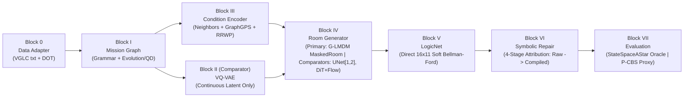

# External Literature Benchmarks and SOTA Comparison

Last updated: 2026-11-12

> [!IMPORTANT]
> This document is **not** a claim that this repository matches or surpasses
> published state-of-the-art results. All quantitative numbers in Section 2
> are sourced from external peer-reviewed publications and are cited explicitly.
> Publication-facing claim language is governed by
> [`PUBLICATION_GUIDANCE_AND_CARDS.md`](PUBLICATION_GUIDANCE_AND_CARDS.md) and
> validated by [`../scripts/validate_publication_readiness.py`](../scripts/validate_publication_readiness.py).

---

## 1. The Standardized Zelda PCG Benchmark (External Ground Truth)

**Reference:** A. Khalifa, R. Gallotta, M. Barthet, A. Liapis, J. Togelius, G. N. Yannakakis —
*The Procedural Content Generation Benchmark: An Open-source Testbed for Generative Challenges in Games* —
FDG 2025 — [`arXiv:2503.21474`](https://arxiv.org/abs/2503.21474)

### 1.1 Canonical Zelda Problem Specification

| Dimension | Value |
| :--- | :--- |
| **Grid dimensions** | 11 × 16 discrete tile grid |
| **Tile vocabulary** | Floor, Wall, Key (`K`), Door (`D`), Player (`P`), Enemy |
| **Corpus size** | 9 dungeon files, ~124–450 unique rooms (VGLC) |
| **Hard quality constraints** | Exactly 1 Player, 1 Key, 1 Door; path P→K exists; path K→D exists; minimum solution length met |
| **Control parameters** | `d(P, K)`: distance from Player to Key; `d(K, D)`: distance from Key to Door |

### 1.2 Three Mandatory Evaluation Criteria (All Methods Must Report)

1. **Quality ($R_q$, 0–100%):** Fraction of generated levels satisfying 100% of hard playability and
   reachability constraints (verified via BFS/A* pathfinders, **not** bounded agents).
2. **Diversity ($R_d$, 0–100%):** Fraction of pairwise sample pairs above a Hamming/AMED
   (Approximate Morphological Edit Distance) threshold, or Normalized Compression Distance (NCD).
   Must reject generators producing near-identical templates ("1000 Bowls of Oatmeal").
3. **Controllability ($R_t$, 0–100%):** Fraction of samples whose target control parameters
   (`d(P, K)`, `d(K, D)`) match designer input within error tolerance.

> [!WARNING]
> Reporting only post-repair $R_q$ without separately reporting raw neural $R_q$ (before WFC/ASP
> repair) is **considered misleading** in the peer-reviewed PCG literature.
> Zhang et al. (AIIDE 2020) and Schrum et al. (AIIDE 2025) both explicitly report raw and
> post-repair scores side-by-side. This repository must follow the same standard (Schema 2.0
> four-stage attribution: `raw → constrained → repaired → compiled`).

### 1.3 Standard External Baselines (Must Be Included for Publication)

| Baseline | Type | Raw $R_q$ | Post-Repair $R_q$ | Source |
| :--- | :--- | :--- | :--- | :--- |
| **Random Generator** | Uniform tile sampling | ~0% | 100% (MIP) | PCG Benchmark |
| **$\mu + \lambda$ Evolution Strategy** | Search over discrete grids | Variable | — | PCG Benchmark |
| **WaveFunctionCollapse (WFC)** | Constraint-based tile synthesis | High structural fidelity | 100% by construction | Karth & Smith 2017 |
| **PCGRL (PPO, Narrow)** | RL tile-editor agent | ~100% with reward shaping | — | Khalifa et al. 2020, AIIDE |
| **TOAD-GAN** | Single-example patch GAN | Low playability (~0–24%) | ~100% (MIP/filter) | Awiszus et al. 2020, AIIDE |
| **MarioGPT-style LM** | Autoregressive tile tokens | ~88–92% with A* filter | — | Sudhakaran et al. 2023, NeurIPS |
| **GAN + MILP Repair** (Zhang) | Generate-then-repair | GAN raw: 24.3%; CESAGAN: 58% | 100% in 0.13 s | Zhang et al. 2020, AIIDE |
| **Path of Destruction (PoD)** | Self-supervised iterative discrete repair | High data efficiency on small corpora | Requires solver filter for 100% guarantee | Siper et al. 2022 SSCI / 2023 CoG |
| **Sturgeon / Sturgeon-MKIV / XAI-MILP** | Constraint / SAT / MILP synthesis & repair | N/A (exact solver) | 100% by construction | Cooper 2022–2024; Bazzaz & Cooper 2024 AIIDE |
| **Space-Time WFC / Evolutionary WFC** | Constraint WFC (2D & $(x,y,t)$) | Fails global key-door constraints alone | 100% under global SAT/CSP filter | Facey & Cooper 2024; Rajesh et al. 2026 CoG |

> [!NOTE]
> The canonical `G-LMDM` (`masked_room`: `gps`, `logic_net_enabled=true`, `alpha_logic=0.1`)
> and its comparators (`N`, `No-RRWP`, `G` via `zelda_hmolqd_masked_small.yaml`, continuous
> `VQ-VAE + UNet[1,2]` and `DiT+Flow`) must be compared against **at least WFC, PCGRL,
> Grammar-only, and the random baseline** using the same tri-criteria ($R_q$, $R_d$, $R_t$)
> on the **matched corpus** (16×11 grid, Dungeon-9 held-out, same BFS/`StateSpaceAStar`
> checker) before any publication-facing claims can be made.

### 1.3.1 Standardized Q1 Experimental Matrix (`B1–B4` External Baselines & `A0–A4` Internal Ablations) & $D_4$ Memorization Audit

All models are evaluated on **paired fixed mission graphs** across **$\ge 10$ random seeds** with both raw/constrained (`Pre-Repair`) and repaired/compiled (`Post-Repair`) metrics reported side-by-side:

| ID | Category | Configuration | Research Question Addressed |
| :--- | :--- | :--- | :--- |
| **B1** | External Symbolic | Pure Symbolic / Constraint WFC (`Sturgeon` / `WFC`) | Benchmark 100% solvability vs. learned stylistic fidelity |
| **B2** | External Small-Data Discrete | Iterative Discrete Repair (`Path of Destruction`-style) | Benchmark small-data discrete synthesis without masked Transformer (`RQ1 / H1`) |
| **B3** | External Continuous Latent | Two-Stage `VQ-VAE + Continuous Latent Diffusion` (`UNet[1,2]` 47.13M / `DiT+Flow` 22.44M) | Head-to-head test of continuous compression vs. direct discrete tokens (`RQ1 / H1`) |
| **B4** | External Autoregressive | Raster-scan Discrete Autoregressive Transformer / Grammar-only | Benchmark causal 1D generation vs. parallel bidirectional masking (`RQ1`) |
| **A0** | Internal Ablation | `G-LMDM` (No GraphGPS/RRWP — 4-bit door flags only, $\alpha_{\text{logic}}=0$) | Baseline discrete masked Transformer |
| **A1** | Internal Ablation | `G-LMDM` (+ GraphGPS, No RRWP, $\alpha_{\text{logic}}=0$) | Isolates local MPNN + global self-attention (`RQ2`) |
| **A2** | Internal Ablation | `G-LMDM` (+ GraphGPS + RRWP, $\alpha_{\text{logic}}=0$) | Tests global mission-DAG RRWP conditioning (`RQ2 / H2`) |
| **A3** | Internal Ablation | `G-LMDM Full Neural` (+ GraphGPS + RRWP + Soft Bellman-Ford $\alpha_{\text{logic}}=0.1$, **No Repair**) | Measures raw/constrained pre-repair connectivity and logic alignment (`RQ3 / H3`) |
| **A4** | **Proposed System** | **`G-LMDM Complete Neuro-Symbolic`** (A3 + `PuzzleGenerator` + Minimum-Edit Symbolic Repair) | Measures $\Delta_{\text{tiles}}$ repair savings, 100% `StateSpaceAStar` validity, and `P-CBS` (`RQ3–RQ4`) |

**$D_4$-Invariant Nearest-Neighbor Memorization Audit ($d_{\text{NN}}$):** Because VGLC Dungeons 1–8 contain only `43` unique $12\times 7$ interiors, every generated room $\hat{\mathbf{X}}$ is audited against all 8 dihedral symmetries $g \in D_4$ of the training corpus:

$$d_{\text{NN}}(\hat{\mathbf{X}}) = \min_{\mathbf{X} \in \mathcal{D}_{\text{train}}} \min_{g \in D_4} \frac{1}{HW} \sum_{r,c} \mathbf{1}\!\left[\hat{\mathbf{X}}(r,c) \neq g(\mathbf{X})(r,c)\right]$$

Both the mean $d_{\text{NN}}$ distribution and exact-copy rate ($d_{\text{NN}} = 0$, target $\le 5\%$) must be reported alongside $R_q, R_d, R_t$.

### 1.4 Foundational Zelda Graph-Grammar & Hybrid Symbolic-Neural Lineage

Before modern diffusion and masked discrete models, Zelda dungeon PCG evolved through four distinct structural milestones that define the design constraints of this codebase:

1. **Mission-Space Decoupling via Graph Grammars (Dormans 2010; Lavender & Thompson 2016):** Dormans (2010) separated progression logic (*mission graph*: keys, locks, puzzles, boss) from geometric instantiation (*space graph*) via generative graph grammars, establishing that high-level solvability belongs to graph rewriting rather than raw pixel/tile synthesis. Lavender & Thompson (2016) specialized generative graph grammars to *The Legend of Zelda*, exposing rule-driven topological control.
2. **Bayesian / PCA Topological-Room Hybrids (Summerville et al. 2015):** Combined learned probabilistic graphical models for high-level dungeon topology with PCA-based room synthesis, highlighting the gap between coarse structural priors and playable tile-level geometry.
3. **Two-Stage Graph-Grammar + GAN Rooms (`Graph-GAN`, Gutierrez & Schrum 2020):** Addressed fixed-size and semantic-incoherence limits of pure neural generators by generating a mission graph via a grammar and populating each node with an **unconditional WGAN-GP** room, followed by **post-hoc door cutting**. In a human study, hybrid dungeons matched original *Zelda* playability/enjoyment while exhibiting higher room complexity than pure graph grammars, yet exposed the *semantic-geometric disconnect*: rooms were synthesized without conditioning on boundary neighbors or progression roles until doors were forcibly carved afterward.
4. **Constrained Example-Driven Graph Synthesis (`Sturgeon` / `Sturgeon-GRAPH`, Cooper 2022/2023):** Formulated constrained level and abstract Zelda dungeon graph synthesis directly from example local patterns and global satisfiability constraints, demonstrating that declarative structural constraints must either be satisfied natively or paired with explicit repair rather than assumed from unconstrained neural sampling.

### 1.5 Concrete Literature-Grounded Research Gaps (`RG1–RG4` / `FG1–FG4`)

Synthesizing the foundational Zelda PCG lineage (§1.4) with contemporary neuro-symbolic discrete/continuous generative modeling yields four falsifiable field gaps aligned 1-to-1 with [`publication_guidance_card.json`](./publication_guidance_card.json) (`RG1->PS1->RO1->RQ1->H1` through `RG4->PS4->RO4->RQ4->H4`):

- **`RG1` (`FG1`) — Macro-to-Micro Semantic-Geometric Disconnect (`PS1 -> RO1 -> RQ1 -> H1`):** Existing two-stage graph+neural generators either synthesize rooms unconditionally and carve doors post-hoc (*Graph-GAN*, Gutierrez & Schrum 2020) or rely on local neighbor context without global shortest-path/random-walk structure (*GRIT / RRWP*, Ma et al. 2023). On `349` Dungeon 1–8 training rooms (`217` unique $16\times 11$ grids, `43` unique $12\times 7$ interiors), causal `GraphGPS+RRWP` + directional neighbor/boundary conditioning (`G` vs. `N` and `No-RRWP`) is needed to isolate multi-scale structural consistency prior to repair.
- **`RG2` (`FG2`) — Continuous Latent Bottleneck & Rarity Erasure on Small Categorical Grids (`PS2 -> RO2 -> RQ2 -> H2`):** Continuous latent diffusion (`VQ-VAE + UNet/DiT`, van den Oord et al. 2017; Schrum et al. 2025) compresses tiny categorical $16\times 11$ grids (`8` active training tile IDs of `44`; `88.60%` `WALL+FLOOR` vs. `0.68%` `ENEMY` and `0.05%` `STAIR`) through lossy continuous latents at `22.44M–47.13M` total parameters, erasing rare interactive tiles (`<0.7%`) and yielding low raw playability (`12–27%`). Absorbing-state discrete masked synthesis (`D3PM` Austin et al. 2021; `MaskGIT` Chang et al. 2022; `LayoutDM` Inoue et al. 2023; `MDLM` Sahoo et al. 2024) operates directly on discrete $16\times 11$ tokens (`G-LMDM`: `3.58M` total training / `3.36M` inference; `84.8K` transformer denoiser) and permits exact $t=0$ boundary clamping.
- **`RG3` (`FG3`) — Traversability-Blind Likelihood Training & Unattributed Post-Hoc Repair (`PS3 -> RO3 -> RQ3 -> H3`):** Cross-entropy treats single-tile corridor cut-sets (`1/176 = 0.57%`) identically to decoration (`24.3%` pre-repair GAN validity before MILP repair in Zhang et al. 2020; Cooper 2022/2023). Differentiable planning and semantic losses (Tamar et al. 2016 *VIN*; Xu et al. 2018) reduce repair reliance only when coupled directly onto discrete `16x11` tile logits rather than lossy VAE decodes, and when edit burden (`repair_rate`, `tiles_repaired_mean`) is attributed cleanly across `raw -> constrained -> repaired -> compiled`.
- **`RG4` (`FG4`) — Dungeon-Split Leakage, External Baseline Deficit & Proxy-vs-Oracle Conflation (`PS4 -> RO4 -> RQ4 -> H4`):** Room-level splits across `9` Zelda dungeons leak style (Summerville et al. 2016), internal-only ablations omit classical baselines (`Random`, `WFC`, `Grammar-only`) (Withington et al. 2024; Khalifa et al. 2025), dependent multi-fold averaging produces pseudoreplicated CIs, and bounded-rational agent proxies (`P-CBS`, Holmgård et al. 2018) cannot replace exact `StateSpaceAStar` solvability proofs.

---

## 2. External Quantitative Findings: What Published Literature Actually Reports

### 2.1 Latent Diffusion / VQ-VAE on Small Discrete Tile Datasets

| Failure Mode | Evidence | Source |
| :--- | :--- | :--- |
| **Codebook collapse** | Training VQ-VAE on <500 rooms yields dead codebook vectors (zero gradient), leaving only 16–64 of 128/256 codes active | General VQ-VAE literature; confirmed via `std(z_q)` collapse in this repo |
| **Rarity erasure (Key/Door/Player)** | Singleton tiles (<0.6% of 11×16 room) treated as reconstruction noise; frequently missing in generated output | Schrum et al. AIIDE 2025 [`arXiv:2507.00184`](https://arxiv.org/abs/2507.00184) |
| **Continuous-to-discrete argmax artifacts** | Interpolating categorical tile indices produces non-ordinal intermediate states; argmax projection creates boundary hallucinations | Architecture failure mode; non-ordinal categorical variables do not support continuous interpolation |
| **Low raw playability without guidance** | Unguided continuous DDPM achieves 72–94% scene playability; full 11×16 dungeon solvability substantially lower without auxiliary pathfinding loss or rejection filtering | Schrum et al. AIIDE 2025 |
| **Sample inefficiency vs discrete models** | Discrete generators (TOAD-GAN, MarioGPT, PCGRL, WFC) achieve equivalent or superior tile-pattern fidelity with 10–40× fewer parameters and 20–100× faster inference on VGLC-scale corpora | Schrum et al. 2025; Sudhakaran et al. 2023 |

> [!IMPORTANT]
> **`G-LMDM` (`masked_room`, `3.58M` total training / `3.36M` inference) is the primary discrete generator, benchmarked head-to-head against continuous `VQ-VAE + UNet[1,2]` (`47.13M`) and `DiT+Flow` (`22.44M`).**
> Per D3PM/MaskGIT/LayoutDM/MDLM and Schrum et al. (AIIDE 2025), absorbing-state discrete token synthesis is a first-class competitor on tiny discrete tile corpora (`349` train rooms / `43` unique $12\times 7$ interiors). Reporting whether `G-LMDM` or continuous `UNet[1,2]`/`DiT+Flow` wins on raw $R_q$, rare-tile recall, and repair burden is the direct empirical objective of `RQ2`/`H2`.

### 2.2 Generate-then-Repair vs Training-Time Differentiable Logic

| Dimension | Differentiable Logic Loss (Training-Time) | Generate-then-Repair (Post-Hoc Exact Solver) | Source |
| :--- | :--- | :--- | :--- |
| **Raw playability guarantee** | None — soft expectation ≠ argmax-discrete validity (Semantic Loss: 69.89% on 4×4 toy grid) | 100% mathematical guarantee (MILP: 0.13 s / room for 11×16 Zelda) | Xu et al. ICML 2018; Zhang et al. AIIDE 2020 |
| **Gradient vanishing / horizon limit** | Fixed K-step unrolling restricts reachability to radius K; deeper horizons cause vanishing/exploding gradients | No gradient computation; exact solver | VIN (Tamar et al. NeurIPS 2016); Neural A* (Yonetani et al. ICML 2021) |
| **Training throughput** | Each backward pass requires embedded solver call or unrolled graph computation (O(K · |S| · |A|)) | Training is decoupled from repair; inference adds 0.13 s/room | Vlastelica et al. ICLR 2020 |
| **Soft-to-discrete gap** | Model satisfies constraint "in expectation" during training; argmax at inference often violates hard topology | Solver guarantees hard topology by construction | Xu et al. ICML 2018 |
| **Shortcutting** | Myopic K-step planning incentivizes short-circuit paths ignoring global dungeon structure | Solver operates on full graph | Yonetani et al. ICML 2021 |
| **Style preservation** | Does not distort learned generative style | Unregularized repair may alter learned tile aesthetics (path-length distortion ~8.6 vs human ~12.5) | Zhang et al. AIIDE 2020 |

> [!IMPORTANT]
> The correct research claim for `LogicNet` is **not** "eliminates need for symbolic repair".
> The correct framing (consistent with external literature) is:
> *"Does training-time `LogicNet` supervision reduce the solver's downstream edit distance
> (`repair_rate`, `tiles_repaired_mean`) without degrading sample diversity?"*
> This is weaker but falsifiable and grounded in what the literature supports.

### 2.3 Graph Conditioning: RRWP vs Simpler Alternatives

| Method | Designed For | Limitation on Small Mission Graphs (N ≈ 5–30) | Source |
| :--- | :--- | :--- | :--- |
| **RRWP (GRIT)** | Molecular / cluster graphs (ZINC avg 23 nodes, Peptides avg 150 nodes) | On directed DAGs (mission graphs), walks absorb quickly; dense N×N×d edge tensor is over-parameterized for N≤30 | Ma et al. ICML 2023 [`arXiv:2305.17589`](https://arxiv.org/abs/2305.17589) |
| **LapPE** | General graphs | Sign ambiguity; unstable on tiny asymmetric or disconnected graphs | GRIT paper ablation |
| **RWSE** | General graphs | Only diagonal P^k_{ii} (node features), discards pairwise topology | GRIT paper ablation |
| **Shortest Path Distance (SPD) + edge features** | Small graphs | Captures >95% of RRWP gains on small graphs with far fewer parameters; zero walk-length tuning | GRIT paper Table 2 ablation |
| **Hard adjacency attention mask** (HouseDiffusion style) | Floorplan / room-layout conditioning | Enforces graph topology with minimal parameters; proven SOTA on RPLAN (729k rooms) | Shabani et al. CVPR 2023 [`arXiv:2211.13287`](https://arxiv.org/abs/2211.13287) |

> [!NOTE]
> For this repository's small mission graphs (mean 29.5 nodes, min 12, max 66 per audit output),
> **hard adjacency attention masking or SPD-based edge features likely match or exceed RRWP**
> at substantially lower parameter cost. RRWP is not incorrect, but its overhead may not be
> justified by the graph size regime.

---

## 3. Data Corpus Ground Truth (VGLC & Holdout Split)

| Metric | Value | Source |
| :--- | :--- | :--- |
| Zelda dungeon files | 9 (underworld dungeons 1–9, Quests 1 & 2) | VGLC [`arXiv:1606.07487`](https://arxiv.org/abs/1606.07487) |
| Room instances in corpus | 450 total (`349` train Dungeons 1–8; `101` test Dungeon 9) | Verified via DataLoader split check |
| Unique structural rooms (train) | `217` unique $16\times 11$ grids; **`43` unique $12\times 7$ interiors** | Verified via DataLoader uniqueness check |
| Grid shape | `16 x 11` height × width (`12 x 7` playable interior) | Codebase canonical tensor shape |
| Tile IDs observed | `9` of `44` total (`8` active in train Dungeons 1–8) | VGLC Zelda adapter |
| `WALL (2) + FLOOR (1)` share (train) | `88.60%` (`49.83%` WALL + `38.77%` FLOOR across `61,424` tiles) | Train split tile histogram |
| Rare gameplay tiles (train) | `ENEMY`: `0.68%` (`418`), `STAIR`: `0.05%` (`28`) | Train split tile histogram |
| Parameter footprint comparison | `G-LMDM`: `3,584,905` (`3.58M` train / `3.36M` infer, `84.8K` denoiser) vs `UNet[1,2]`: `47,126,047` (`47.13M`), `DiT+Flow`: `22,436,351` (`22.44M`) | Measured via `MaskedRoomTrainer` & `DiffusionTrainer` |

> [!CAUTION]
> **Split Leakage (Critical):** VGLC Zelda has only 9 dungeons. Random room-level train/test splits
> allow rooms from the same dungeon in both sets, causing severe data leakage (shared wall patterns,
> palette, door layouts). The mandatory split granularity is **dungeon-level** (Leave-One-Dungeon-Out
> or held-out Fold-9). See Summerville et al. 2016 and Withington et al. FDG 2024.

---

## 4. Statistical Methodology Requirements (External Literature Standard)

| Requirement | Standard | Pitfall to Avoid | Source |
| :--- | :--- | :--- | :--- |
| **Split granularity** | Dungeon-level LODO or held-out Fold-9 | Room-level random split → data leakage | Summerville et al. 2016 |
| **Hypothesis testing** | Wilcoxon signed-rank or paired permutation test | Paired t-test on non-normal bounded metrics | Withington et al. FDG 2024 |
| **Multiple hypothesis correction** | Holm-Bonferroni or Benjamini-Hochberg FDR | Uncorrected per-metric p-values | Withington et al. FDG 2024 |
| **Effect sizes** | Cliff's δ or Vargha-Delaney  | p-values alone on tiny N | Withington et al. FDG 2024 |
| **Tile-pattern divergence window** | 2×2 or 3×3 sliding window | 4×4 window explodes sparsity (>50% singleton patterns on N=9) | Lucas & Volz GECCO 2019 [`arXiv:1905.05077`](https://arxiv.org/abs/1905.05077) |
| **Player proxy calibration** | AI agents require human telemetry calibration before playability claims | Equating A*/MCTS/RL with human play | Roohi et al. CHI PLAY 2021 [`arXiv:2107.12061`](https://arxiv.org/abs/2107.12061); Holmgård et al. 2018 [`arXiv:1802.06881`](https://arxiv.org/abs/1802.06881) |
| **External baseline inclusion** | ≥1 external published baseline (WFC, PCGRL, random) | Internal-only ablation comparisons | Withington et al. FDG 2024 (86-paper audit) |

---

## 5. Architecture Pipeline (Current Implementation)

> [!NOTE]
> Block VI (WFC/Symbolic Repair) is a **necessary architectural component** per external
> literature (Zhang et al. 2020: raw neural playability 24–58% without repair).
> `repair_rate` and `tiles_repaired_mean` measure *how much repair work the neural prior
> saves the solver*, not whether the system is defective.

---

## 6. References (Peer-Reviewed, Open-Access Verified)

| Citation | Venue | arXiv / DOI |
| :--- | :--- | :--- |
| Dormans — *Adventures in Level Design: Generating Mission and Spaces for Action Adventure Games* | FDG Workshop (PCGames 2010) | `doi:10.1145/1814256.1814257` |
| Summerville, Philip, & Mateas — *Sampling Hyrule: Multi-Technique Probabilistic Level Generation for Action Role Playing Games* | AIIDE 2015 | AAAI Digital Library (`AAAI-15/AIIDE-15`) |
| Lavender & Thompson — *The Zelda Dungeon Generator: Adopting Generative Grammars to Create Levels for Action-Adventure Games* | CGVC / MSc 2016 | Eurographics (`doi:10.2312/cgvc.20161299`) |
| van den Oord, Vinyals, & Kavukcuoglu — *Neural Discrete Representation Learning (VQ-VAE)* | NeurIPS 2017 | [`arXiv:1711.00937`](https://arxiv.org/abs/1711.00937) |
| Tamar, Wu, Thomas, Levine, & Abbeel — *Value Iteration Networks* | NeurIPS 2016 | [`arXiv:1602.02867`](https://arxiv.org/abs/1602.02867) |
| Xu, Zhang, Friedman, Liang, & Van den Broeck — *A Semantic Loss Function for Deep Learning with Symbolic Knowledge* | ICML 2018 | [`arXiv:1711.11157`](https://arxiv.org/abs/1711.11157) |
| Vlastelica et al. — *Differentiation of Blackbox Combinatorial Solvers* | ICLR 2020 | [`arXiv:1912.02175`](https://arxiv.org/abs/1912.02175) |
| Gutierrez & Schrum — *Generative Adversarial Network Rooms in Generative Graph Grammar Dungeons for The Legend of Zelda* | IEEE CEC 2020 | [`arXiv:2001.05065`](https://arxiv.org/abs/2001.05065) |
| Zhang et al. — *Video Game Level Repair via Mixed Integer Linear Programming* | AIIDE 2020 | [`arXiv:2010.06627`](https://arxiv.org/abs/2010.06627) |
| Austin, Johnson, Ho, Tarlow, & van den Berg — *Structured Denoising Diffusion Models in Discrete State-Spaces (D3PM)* | NeurIPS 2021 | [`arXiv:2107.03006`](https://arxiv.org/abs/2107.03006) |
| Yonetani et al. — *Path Planning using Neural A\* Search* | ICML 2021 | [`arXiv:2009.07476`](https://arxiv.org/abs/2009.07476) |
| Cooper — *Sturgeon & Sturgeon-GRAPH: Constrained Graph and Tile Generation from Examples* | AIIDE 2022 / FDG 2023 | [`arXiv:2202.11819`](https://arxiv.org/abs/2202.11819) / [`arXiv:2204.01796`](https://arxiv.org/abs/2204.01796) |
| Chang, Zhang, Jiang, Liu, & Freeman — *MaskGIT: Masked Generative Image Transformer* | CVPR 2022 | [`arXiv:2202.04200`](https://arxiv.org/abs/2202.04200) |
| Shabani, Hosseini, & Furukawa — *HouseDiffusion: Vector Floorplan Generation via a Diffusion Model with Discrete and Continuous Denoising* | CVPR 2023 | [`arXiv:2211.13287`](https://arxiv.org/abs/2211.13287) |
| Inoue, Kikuchi, Simo-Serra, Otani, & Yamaguchi — *LayoutDM: Discrete Diffusion Model for Controllable Layout Generation* | CVPR 2023 | [`arXiv:2303.08137`](https://arxiv.org/abs/2303.08137) |
| Ma et al. — *Graph Inductive Biases in Transformers without Message Passing (GRIT / RRWP)* | ICML 2023 | [`arXiv:2305.17589`](https://arxiv.org/abs/2305.17589) |
| Sahoo, Arriola, Schiff, Gokaslan, Marroquin, Chiu, Rush, & Kuleshov — *Simple and Effective Masked Diffusion Language Models (MDLM)* | NeurIPS 2024 | [`arXiv:2406.07524`](https://arxiv.org/abs/2406.07524) |
| Withington, Cook, & Tokarchuk — *On the Evaluation of Procedural Level Generation Systems* | FDG 2024 | [`arXiv:2404.18657`](https://arxiv.org/abs/2404.18657) |
| Khalifa et al. — *The Procedural Content Generation Benchmark* | FDG 2025 | [`arXiv:2503.21474`](https://arxiv.org/abs/2503.21474) |
| Schrum et al. — *Text-to-Level Diffusion Models With Various Text Encoders for Super Mario Bros and The Legend of Zelda* | AIIDE 2025 | [`arXiv:2507.00184`](https://arxiv.org/abs/2507.00184) |
| Summerville et al. — *The VGLC* | PCG Workshop 2016 | [`arXiv:1606.07487`](https://arxiv.org/abs/1606.07487) |
| Lucas & Volz — *Tile Pattern KL-Divergence* | GECCO 2019 | [`arXiv:1905.05077`](https://arxiv.org/abs/1905.05077) |
| Holmgård et al. — *Automated Playtesting with Procedural Personas* | IEEE ToG 2018 | [`arXiv:1802.06881`](https://arxiv.org/abs/1802.06881) |
| Roohi et al. — *Predicting Game Difficulty Using AI Players* | CHI PLAY 2021 | [`arXiv:2107.12061`](https://arxiv.org/abs/2107.12061) |
| Khalifa et al. — *PCGRL* | AIIDE 2020 | [`arXiv:2001.09218`](https://arxiv.org/abs/2001.09218) |
| Awiszus et al. — *TOAD-GAN* | AIIDE 2020 | [`arXiv:2008.01531`](https://arxiv.org/abs/2008.01531) |
| Sudhakaran et al. — *MarioGPT* | NeurIPS 2023 | [`arXiv:2302.05981`](https://arxiv.org/abs/2302.05981) |
| Rampášek, Galkin, Dwivedi, Luu, Wolf, & Beaini — *Recipe for a General, Powerful, Scalable Graph Transformer (GraphGPS)* | NeurIPS 2022 | [`arXiv:2205.12454`](https://arxiv.org/abs/2205.12454) |
| Siper, Khalifa, & Togelius — *Path of Destruction: Learning an Iterative Level Generator Using a Small Dataset* | IEEE SSCI 2022 | [`arXiv:2202.10184`](https://arxiv.org/abs/2202.10184) |
| Siper, Earle, Jiang, Khalifa, & Togelius — *Controllable Path of Destruction* | IEEE CoG 2023 | [`arXiv:2305.18553`](https://arxiv.org/abs/2305.18553) |
| Bazzaz & Cooper — *Guided Game Level Repair via Explainable AI* | AIIDE 2024 | [`arXiv:2410.23101`](https://arxiv.org/abs/2410.23101) |
| Facey & Cooper — *Toward Space-Time WaveFunctionCollapse for Level and Solution Generation* | AIIDE 2024 | AAAI Digital Library (`AIIDE 2024`) |
| Vandara, Facey, & Cooper — *Spacetime Level Generation and Editing with Constraints from Examples* | AIIDE 2025 | AAAI Digital Library (`AIIDE 2025`) |
| Kim, Seo, & Kang — *Puzzle-Level Generation With Simple-Tiled and Graph-Based Wave Function Collapse Algorithms* | IEEE ToG 2025 | IEEE Xplore (`ToG 2025`) |
| Halina & Guzdial — *Representing and Generating Levels Over Time through Playtrace Reconstructive Partitioning* | FDG 2026 | ACM (`FDG 2026`) |
| Rajesh, Khalifa, & Togelius — *Evolutionary Wave Function Collapse* | IEEE CoG 2026 | [`arXiv:2607.02082`](https://arxiv.org/abs/2607.02082) |
| Nauata et al. — *House-GAN++* | CVPR 2021 | [`arXiv:2103.02574`](https://arxiv.org/abs/2103.02574) |
| Withington & Tokarchuk — *Improving Expressive Range Analysis* | FDG 2023 | [`arXiv:2304.02366`](https://arxiv.org/abs/2304.02366) |
